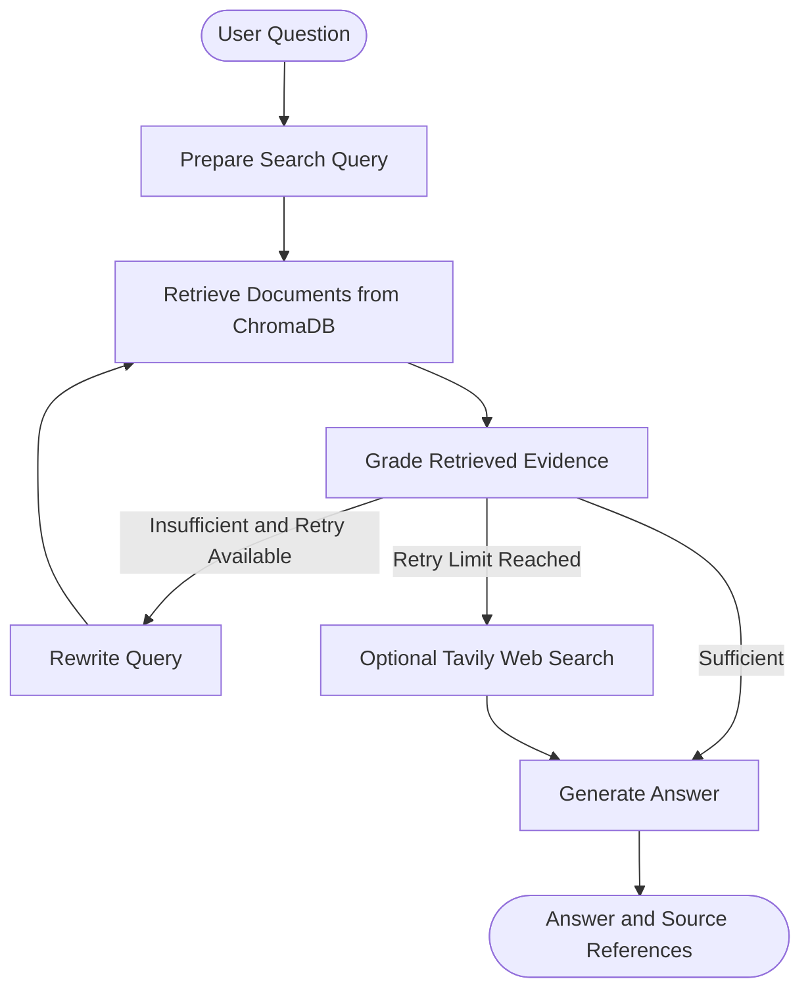

# Agentic RAG Assistant

An AI-powered assistant that answers questions using private documents, evaluates retrieved evidence, rewrites search queries when necessary, and conditionally routes the workflow using **LangGraph**.

The project combines local large language models, vector-based retrieval, and agentic workflow orchestration to build a document-grounded question-answering system.

## Overview

Traditional LLM applications generate answers directly from a user's prompt and the model's learned knowledge. However, they may not know the contents of private documents or up-to-date information.

This project addresses that limitation using Retrieval-Augmented Generation (RAG). It retrieves relevant information from an indexed knowledge base and supplies that evidence to the language model.

LangGraph adds conditional routing, allowing the system to evaluate retrieval results, retry with an improved query, and attempt an optional web-search fallback when internal evidence is insufficient.

### Key Features

- **Document ingestion:** Load PDF, DOCX, TXT, Markdown, and HTML documents.
- **Text chunking:** Split documents into smaller, overlapping passages for retrieval.
- **Local embeddings:** Generate document and query embeddings using Ollama.
- **Vector search:** Store and retrieve document chunks using ChromaDB.
- **Agentic workflow:** Orchestrate query preparation, retrieval, evidence grading, retries, and answer generation with LangGraph.
- **Query rewriting:** Improve search queries when initial retrieval does not provide sufficient evidence.
- **Evidence-based answers:** Instruct the language model to answer using retrieved context and acknowledge missing information.
- **Source references:** Display the sources associated with the retrieved evidence.
- **Optional web search:** Integrate Tavily as a fallback when external access and API credentials are available.
- **Local inference:** Run the language model and embedding model locally through Ollama.

## Architecture



### Workflow

1. **Query preparation:** The LLM converts the original question into a search-friendly query.
2. **Document retrieval:** The query is embedded and used to retrieve relevant passages from ChromaDB.
3. **Evidence grading:** The LLM evaluates whether the retrieved passages contain sufficient information to answer the question.
4. **Conditional routing:** LangGraph selects the next node based on the evidence grade and remaining retrieval attempts.
5. **Query rewriting:** If the evidence is insufficient and a retry remains, the system generates an improved query and retrieves again.
6. **Web fallback:** After the retrieval retry limit is reached, the system attempts Tavily search if configured and available.
7. **Answer generation:** The LLM generates a response using the available evidence and includes source labels where applicable.

If no usable evidence is available, the system is designed to acknowledge that it cannot verify the answer.

**Note:** The current implementation does not independently grade web results or validate every generated citation. These are planned improvements.

## Technology Stack

| Technology | Purpose |
|---|---|
| Python | Application logic |
| LangGraph | Stateful workflow orchestration and conditional routing |
| Ollama | Local model inference and embeddings |
| Qwen 2.5 7B | Query rewriting, evidence grading, and answer generation |
| `nomic-embed-text` | Text embeddings |
| ChromaDB | Persistent vector storage and similarity search |
| LangChain Text Splitters | Document chunking |
| PyMuPDF | PDF text extraction |
| python-docx | Word document extraction |
| BeautifulSoup4 | HTML parsing |
| Requests | Fetching web pages |
| python-dotenv | Loading environment variables |
| LangChain Tavily | Optional web-search integration |

## Project Structure

```text
agentic-rag-assistant/
│
├── app/
│   ├── __init__.py
│   ├── rag.py
│   │
│   ├── graph/
│   │   ├── __init__.py
│   │   ├── state.py
│   │   ├── nodes.py
│   │   └── workflow.py
│   │
│   ├── ingestion/
│   │   ├── __init__.py
│   │   └── loaders.py
│   │
│   └── retrieval/
│       ├── __init__.py
│       └── store.py
│
├── data/
│   ├── documents/
│   └── chroma/
│
├── config.py
├── main.py
├── .env
├── .gitignore
└── README.md
```

### Main Components

- `app/graph/state.py` — defines the shared state used by graph nodes.
- `app/graph/nodes.py` — implements query preparation, retrieval, evidence grading, rewriting, web search, and answer generation.
- `app/graph/workflow.py` — connects the nodes and defines conditional routing.
- `app/ingestion/loaders.py` — extracts text from supported file formats and supplied web-page URLs.
- `app/retrieval/store.py` — chunks text, creates embeddings, stores document chunks, and performs similarity search.
- `config.py` — centralizes model names, paths, chunk settings, and retrieval parameters.
- `main.py` — provides the command-line interface for ingestion and question answering.

## Prerequisites

Install the following before running the application:

- Python 3.12 or a compatible Python version.
- Git.
- Ollama.
- Sufficient RAM and disk space for the selected local models.

The project uses a local LLM and embedding model, so the required resources depend on the models and their configurations.

## Installation

### 1. Clone the repository

```bash
git clone <your-repository-url>
cd agentic-rag-assistant
```

If you have already created the project locally, open its root folder in VS Code instead.

### 2. Create a virtual environment

**Windows PowerShell:**

```powershell
py -3.12 -m venv .venv
.\.venv\Scripts\Activate.ps1
```

If Python 3.12 is not installed, use a compatible installed Python version.

### 3. Install dependencies

```bash
python -m pip install --upgrade pip
python -m pip install ollama chromadb langchain-text-splitters pymupdf python-docx beautifulsoup4 requests langgraph python-dotenv langchain-tavily
```

### 4. Install and start Ollama

Install Ollama from:

https://ollama.com/

Pull the required models:

```bash
ollama pull qwen2.5:7b
ollama pull nomic-embed-text
```

Check that the models are available:

```bash
ollama list
```

Ollama must be running when you execute the application.

### 5. Configure environment variables

Create a `.env` file in the project root:

```env
TAVILY_API_KEY=
```

The Tavily API key is optional for local document retrieval. Add a valid key only if you are permitted to use the service.

Obtain a key from:

https://tavily.com/

If external API access is restricted by your network or organization, leave the key unset and use the local retrieval workflow.

### 6. Configure the project

The main settings in `config.py` include:

```python
LLM_MODEL = "qwen2.5:7b"
EMBEDDING_MODEL = "nomic-embed-text"
COLLECTION_NAME = "knowledge_base"

CHUNK_SIZE = 900
CHUNK_OVERLAP = 150
RETRIEVAL_K = 4
```

The current text splitter uses character-based chunk sizes. These parameters can be adjusted according to document types and retrieval evaluation results.

## Usage

### 1. Add documents

Place your documents inside:

```text
data/documents/
```

Supported formats:

- PDF (`.pdf`)
- Microsoft Word (`.docx`)
- Plain text (`.txt`)
- Markdown (`.md`)
- HTML (`.html`, `.htm`)

### 2. Index the documents

Run:

```bash
python main.py ingest
```

The application extracts the text, splits it into chunks, creates embeddings, and stores the results in ChromaDB.

The local vector store is persisted under:

```text
data/chroma/
```

Run ingestion again whenever you add or update documents. Existing chunks may be upserted using their generated IDs, but this implementation does not fully manage document deletions or all document-update scenarios.

### 3. Ask a question

```bash
python main.py ask "How many days can employees work remotely?"
```

The application runs the LangGraph workflow and prints the answer, source references, and debugging information.

### 4. Index a web page

```bash
python main.py add-url "https://example.com"
```

This command ingests a specific URL into the local knowledge base. It is different from searching the web for new information at question time.

### 5. Test insufficient evidence

```bash
python main.py ask "What is the company's annual revenue?"
```

If the information is not present in the indexed documents, the system should attempt its fallback path. Whether online search succeeds depends on Tavily configuration, network access, and service availability.

## Configuration

| Setting | Description |
|---|---|
| `LLM_MODEL` | Ollama model used for generation |
| `EMBEDDING_MODEL` | Ollama embedding model |
| `COLLECTION_NAME` | ChromaDB collection name |
| `CHUNK_SIZE` | Maximum chunk size used by the text splitter |
| `CHUNK_OVERLAP` | Overlap between adjacent chunks |
| `RETRIEVAL_K` | Number of chunks retrieved by default |
| `MAX_RETRIEVAL_ATTEMPTS` | Maximum number of retrieval calls per graph run |

The retry limit is currently configured in `app/graph/nodes.py`.

## How It Differs from Basic RAG

A basic RAG pipeline generally follows a fixed sequence:

```text
Question → Retrieval → Answer Generation
```

This project adds conditional decision-making:

```text
Question
   ↓
Retrieve Evidence
   ↓
Evaluate Evidence
   ├── Sufficient → Generate Answer
   └── Insufficient → Rewrite and Retry
                            ↓
                     Web Fallback or Abstain
```

LangGraph manages this conditional workflow. It does not automatically make an application reliable or agentic simply by being installed; the nodes and routing logic define the behavior.

## Limitations

This project is a learning and development prototype. The following limitations should be considered before production use:

- Evidence grading relies on an LLM and may be incorrect.
- Retrieved chunks are not filtered using a calibrated similarity threshold.
- Citation labels are generated by the LLM and are not independently validated.
- Web search is optional and depends on external service access.
- Web results are not independently graded before answer generation.
- Scanned PDFs and complex tables may require OCR or specialized extraction.
- Document permissions and user authentication are not implemented.
- Conversation persistence and multi-turn memory are not implemented.
- Evaluation, monitoring, and production deployment safeguards remain future work.

## Security Considerations

- Never commit `.env` or API keys to version control.
- Use only organization-approved services and credentials on managed devices.
- Treat document contents and web results as untrusted input.
- Apply access controls before retrieving confidential documents.
- Avoid logging sensitive document content or credentials.
- Follow applicable company policies for data storage and external API usage.

A local model does not, by itself, guarantee that the entire application is secure.

## Future Improvements

- Add a dedicated web-evidence grading node.
- Implement citation validation and claim-to-source verification.
- Improve retrieval with similarity thresholds, hybrid search, and reranking.
- Add OCR and improved extraction for tables and scanned documents.
- Implement document versioning, deletion handling, and permission-aware retrieval.
- Add LangGraph checkpointing for persistent conversation threads.
- Expose the workflow through FastAPI and a web interface.
- Add structured logging, execution tracing, and latency monitoring.
- Create an evaluation dataset for retrieval quality, answer correctness, and abstention behavior.
- Add automated tests for graph routing, empty stores, network failures, and conflicting evidence.

## Learning Objectives

This project demonstrates practical experience with:

- Retrieval-Augmented Generation.
- Local LLM inference using Ollama.
- Text embeddings and vector similarity search.
- Document ingestion and chunking.
- LangGraph state, nodes, edges, and conditional routing.
- Query rewriting and evidence grading.
- Source-grounded generation.
- Error handling and retrieval evaluation.

## License

Choose a license before distributing this project publicly. If no license is specified, all rights remain reserved by the copyright holder by default.
